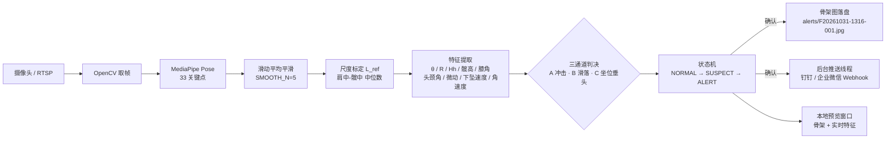
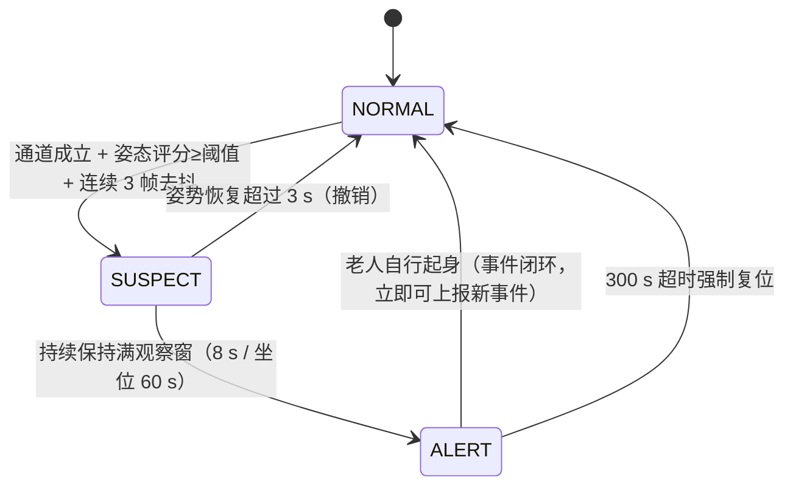
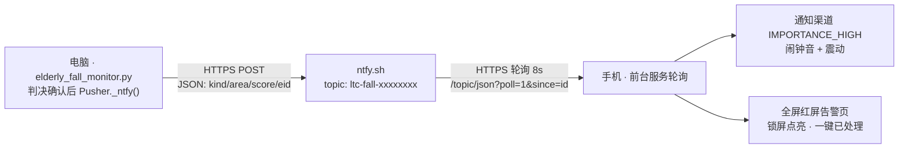

# 基于 AI 人体骨架姿态的居家老人无穿戴跌倒监测预警系统

> 一台普通摄像头 + 一个 Python 脚本，就能 7×24 小时守护独居老人：**不用穿戴任何设备**，只用摄像头识别人体骨架（33 个关键点），判断"跌倒 / 晕倒 / 坐位晕厥 / 久蹲不起"，并在确认后多渠道推送告警。

[](https://www.python.org/)
[](https://developers.google.com/mediapipe)
[](LICENSE)

---

## 为什么做这个

老人跌倒后"黄金 1 小时"内被发现，生存率与预后差距巨大。但现实里：

| 方案 | 问题 |
| --- | --- |
| 穿戴式手环 / 跌倒胸牌 | 老人不愿戴、忘记充电、洗澡时摘下 —— 恰是最危险的时刻 |
| 摄像头人工值守 | 成本高、隐私争议大、不可能 24 小时盯着 |
| 纯 RGB 视频 AI | 云端传视频，隐私不可接受；误报多（坐下、弯腰、捡东西都像跌倒） |

本项目的取舍是：**只处理骨架，不处理人脸和画面**。摄像头画面在本地实时转成 33 个关键点坐标后，原始视频帧即刻丢弃，既不落盘也不上云；告警时推送的也是"火柴人骨架图"，不含任何可辨识的影像信息。

---

## 核心特性

- **无穿戴**：不需要手环、胸牌、床垫，普通 USB 摄像头 / 网络摄像头 / RTSP 即可。
- **三级隐私保护**：视频帧不落盘 → 只存 33 点坐标 → 告警图只有纯黑背景上的骨架线条。
- **三通道判决**，覆盖三类真实跌倒形态，而不是只认"摔倒一瞬间"：
  - **A 通道｜冲击型跌倒**：检测"下坠速度 + 躯干角速度"突变，配合贴地判定 → 适合站立时突然摔倒。
  - **B 通道｜缓慢滑落型晕倒**：检测"头离地比"跨越贴地线的过程 → 适合扶着墙慢慢滑下、无明显冲击的晕厥。
  - **C 通道｜坐位垂头型晕厥**：沙发/椅子上坐着突然失去意识、头长时间下垂不动 → 传统跌倒算法完全检测不到的盲区。
- **状态机去误报**：触发 → `SUSPECT` 观察窗口（跌倒 8 s / 坐位 60 s）→ `ALERT`；中途恢复 3 s 自动撤销。误报率远低于"单帧阈值判断"。
- **尺度归一化**：以"肩中—髋中"距离（L_ref）为单位度量高度和速度，因此**对身高、镜头远近、分辨率不敏感**；开机会自动标定。
- **断流自愈**：RTSP/摄像头掉线自动重连；目标长时间离开画面自动复位状态机。
- **异步告警**：网络推送在后台线程，网络抖动不会卡住视频循环；钉钉 / 企业微信机器人 Markdown 推送，带事件编号、区域、持续时间、置信度、骨架图。
- **久蹲旁路提醒**：低位姿势超过 15 分钟（可能蹲着起不来、也可能只是擦地）→ 发一条"请确认状态"的软提醒，不升级为跌倒告警。

---

## 系统架构



### 判决状态机



---

## 关键指标（全部以 L_ref 归一化）

| 特征 | 含义 | 作用 |
| --- | --- | --- |
| `θ` (theta) | 躯干中轴与竖直方向夹角 | 站立≈0°，倒地≈90° |
| `R` | 关键点外接框 宽/高 比 | 站直时小，横躺时大 |
| `Hh` (hh) | 头离地比（脚底→鼻子）/ L_ref | 站立≈3+，倒地 < 1.3 |
| `hip_h` | 髋离地比 | 区分坐/蹲/躺 |
| `knee` | 膝角 | 蹲、跪、坐的判别 |
| `neck` | 头颈下垂角（颈→头 与 颈→髋 反向比较） | 坐位垂头晕厥的核心特征 |
| `still` | 全身关键点平均位移速度（L/s） | "不动"是危险信号 |
| `drop` | Hh 下降速度 | 冲击型跌倒的前兆 |
| `omega` | 躯干角速度 | 冲击型跌倒的前兆 |
| `score` | 姿态评分 `0.50·f(θ) + 0.35·f(R) + 0.15·f(静止)` | 复合门限 |

---

## 快速开始

```bash
git clone https://github.com/Leeann323/elderly-fall-detection.git
cd elderly-fall-detection
pip install -r requirements.txt

# 用默认摄像头（按需修改脚本顶部配置）
python elderly_fall_monitor.py
```

运行后弹出 `skeleton` 预览窗口，画面上叠加实时状态与特征值，例如：

```
NORMAL - S=0.12 hh=3.41 hip=2.05 neck=12 v=0.08
```

按 `q` 或 `Esc` 退出。

### 配置（脚本顶部 `配置` 区）

| 变量 | 默认值 | 说明 |
| --- | --- | --- |
| `VIDEO_SOURCE` | `0` | `0`=本机摄像头；也可填 `"rtsp://..."`、`"test.mp4"` |
| `AREA` | `"客厅"` | 监测区域名：客厅 / 卧室 / 卫生间 / 书房（写进告警文案） |
| `DINGTALK_WEBHOOK` | `""` | 钉钉或企业微信机器人地址，留空则只在控制台打印告警 |
| `ALERT_DIR` | `"alerts"` | 骨架图落盘目录 |
| `PUBLIC_IMAGE_BASE` | `""` | 若填 `http://192.168.1.10:8000/alerts`，告警消息内嵌图片链接 |
| `CONFIRM_SEC` | `8.0` | 跌倒确认窗口，客厅可放宽到 `15.0` |
| `SEAT_CONFIRM` | `60.0` | 坐位晕厥确认窗口 |
| `SQUAT_REMIND_SEC` | `900.0` | 久蹲软提醒时间 |

`SEAT_AREAS = ("客厅", "卧室", "书房")`：C 通道（坐位垂头）只在允许久坐的区域启用；**卫生间默认关闭**——那里蹲下是正常行为，开了会疯狂误报。

### 阈值调优速查

| 现象 | 调整 |
| --- | --- |
| 频繁把"坐下 / 弯腰"判成跌倒 | 提高 `SCORE_TH`（0.70 → 0.80）、降低 `HH_GROUND`（1.3 → 1.1） |
| 真跌倒没报出来 | 提高 `HH_GROUND`（1.3 → 1.5）、降低 `SCORE_TH`、延长 `CONFIRM_SEC` 无益但可放宽 `IMPACT_WINDOW` |
| 老人坐沙发时误报 C 通道 | 提高 `SEAT_ANGLE`（55 → 65）、缩短 `SEAT_CONFIRM` 无用，应提高 `STILL_LIMIT` 敏感度（调小更敏感） |
| 坐着打瞌睡被误判 | 提高 `SEAT_ANGLE` 到 70°，或把该房间从 `SEAT_AREAS` 移除 |
| 半夜暗光丢点、频繁复位 | 降低 `MIN_VIS`（0.5 → 0.35），加大 `LOST_RESET_SEC`，并补红外补光 |

---

## 手机端远程告警 App（Android）

配套 App：**`跌倒告警`（com.leeann323.fallalert）**，安装包见 [Releases](https://github.com/Leeann323/elderly-fall-detection/releases)。

解决的问题：**子女在外地，手机和家里的电脑不在同一个网络，怎么第一时间收到告警？** 摄像头那台电脑在 NAT 后面没有公网 IP，手机直连它不可能。本方案用公共发布-订阅中转（ntfy.sh，纯 HTTPS 443）打通：



- **零第三方依赖**：不用 AndroidX / Firebase / FCM / GMS，国产无 Google 服务框架的 ROM 也能用；APK 约 30 KB。
- **两种通知形态**：普通通知（带事件编号、区域、置信度）+ 全屏告警页（锁屏也能亮屏弹出），适合夜间。
- **断网自愈**：游标 `since=<lastId>` 持久化，App 被杀重启不漏消息、不重复报。
- **开机自启**：上次处于监听状态则重启后自动继续。
- **告警分级**：`A/B/C/S` 四类与电脑端 `KIND_NAME` 完全对齐，久蹲软提醒也会推。

配置只有两步：

```bash
# 1) 电脑端：把 topic 写进 ntfy_topic.txt（一行，无引号），脚本会自动读
#    也可以用环境变量：set NTFY_TOPIC=ltc-fall-k7m2xq9p
python elderly_fall_monitor.py
# 启动时会打印：
#   [info] 手机远程推送：已启用 -> https://ntfy.sh/ltc-fall-k7m2xq9p
#   若打印“未启用”，说明 topic 没读到，此时告警只会留在本机！

# 2) 手机端：App 里填同一个 topic → 启动监听 → 发送测试告警自检
```

> 💡 **踩坑提醒**：只用环境变量的话，在 Spyder 里按 F5、或双击 `.py` 运行时环境变量往往没生效，表现就是"检测到了但手机没反应，只在本机留了图"。所以推荐 `ntfy_topic.txt` 文件方式（已被 `.gitignore` 排除，不会上传）。

钉钉 webhook 与手机推送可同时启用。详细安装、排查、安全说明见 **[docs/android-app.md](docs/android-app.md)**。

> ⚠️ ntfy.sh 是公共服务，消息在第三方最多缓存 12 小时且默认明文可见，所以**只推"类型/区域/置信度"这类元数据，绝不推视频帧或骨架图**。topic 即密钥，请用随机串。

---

## 目录结构

```
elderly-fall-detection/
├── elderly_fall_monitor.py    # 主程序（单文件：检测 + 判决 + 推送）
├── requirements.txt
├── android-app/               # 手机端 APK 源码（纯 Java，无 Gradle）
│   ├── AndroidManifest.xml
│   ├── src/com/leeann323/fallalert/
│   ├── res/
│   ├── build.ps1              # aapt2 + javac + d8 + apksigner 一键打包
│   └── dist/FallAlert-1.0.apk # 构建产物（已 gitignore，见 Releases）
├── docs/
│   ├── algorithm.md           # 三通道判决、标定、失效场景与调参详解
│   └── android-app.md         # 手机端安装、配置、排查、安全说明
├── alerts/                    # 运行时生成：骨架图（已 gitignore）
├── LICENSE / NOTICE           # Apache-2.0 + 署名要求
├── CITATION.cff               # 学术引用（GitHub “Cite this repository”）
└── README.md
```

---

## 隐私与合规设计

1. **不存原始画面**：`cap.read()` 后立刻 `POSE.process()`，帧对象用完即弃。
2. **告警图是骨架**：`_draw()` 只画连线与关节点，输出纯黑底火柴人，不含皮肤、衣着、环境。
3. **本地推理**：MediaPipe 完全离线，无需 GPU、无上行视频流。
4. **可关闭全部存储**：把 `ALERT_DIR` 指向临时目录，或注释掉 `save_skeleton()` 调用。
5. **建议**：摄像头仅对准床/沙发/过道等必要区域；家中老人与同住者知情同意后安装。

---

## 已知限制

- **遮挡**：被子、家具、逆光会造成关键点缺失，可能漏报；建议低角度、光线均匀安装。
- **多人场景**：当前实现只跟随 MediaPipe 输出的单个人；多人同框时请限定监测区域或换用多人姿态模型。
- **视角**：正面/侧面效果最好；俯视大角度和极端广角会削弱 `Hh` 的判别力。
- **卫生间**：湿滑地面 + 蹲姿，误报风险高，默认不启用 C 通道。
- **非医疗器械**：本系统是辅助提醒工具，不能替代人工看护与专业急救，见下方免责声明。

## 路线图

- [ ] 多目标跟踪（DeepSORT / ByteTrack）+ 区域入侵
- [ ] 轻量模型量化，跑在树莓派 / Jetson Nano / 旧安卓机
- [ ] WebSocket 推流网页看板，取代本地 `imshow`
- [ ] 事件回放：只保留骨架序列（JSON），可重建火柴人动画
- [ ] 语音对讲确认（"您还好吗？"）+ 双向安抚

---

## 开源协议与署名

本项目采用 **[Apache License 2.0](LICENSE)**（OSI 认证），全文见 [`LICENSE`](LICENSE)，署名条款见 [`NOTICE`](NOTICE)。

**一句话结论：可以随便转载、可以闭源商用、可以改，但必须保留版权声明 + NOTICE，并在文档里写明出处。**

| 你做的事 | 允许？ | 必须做的事 |
| --- | --- | --- |
| 个人学习、本地部署、跑着玩 | ✅ | 无 |
| 转载到博客 / 公众号 / CSDN / B 站，或 fork 后再发布 | ✅ | 保留 `LICENSE` + `NOTICE`，文中注明作者与仓库地址 |
| 商业产品、公司内部系统、SaaS 部署 | ✅ | 同上；在产品文档或"关于"页面署名 |
| 修改源码后闭源发布 | ✅ | 修改过的文件要"显著说明已修改"（第 4(b) 条），并继续保留声明 |
| 去掉作者名、把项目说成自己写的 | ❌ | —— 这违反第 4 条，也违反著作权法 |
| 拿作者名义为你的产品背书 | ❌ | —— 第 6 条商标条款不授予此权利 |

### 推荐的署名写法

```
本项目基于「基于 AI 人体骨架姿态的居家老人无穿戴跌倒监测预警系统」
作者 Leeann323，https://github.com/Leeann323/elderly-fall-detection
（Apache License 2.0）
```

学术引用请用仓库内的 [`CITATION.cff`](CITATION.cff)，GitHub 页面右上角 **"Cite this repository"** 可直接生成 APA / BibTeX：

```bibtex
@software{Leeann323_elderly_fall_detection_2026,
  author = {Leeann323},
  title  = {基于 AI 人体骨架姿态的居家老人无穿戴跌倒监测预警系统},
  year   = {2026},
  url    = {https://github.com/Leeann323/elderly-fall-detection},
  license = {Apache-2.0}
}
```

> ⚠️ 一点法律常识：开源协议约束的是**分发行为**。Apache-2.0 的署名义务在"你把代码/二进制交付给别人"时触发；如果只是自己公司内部当 SaaS 用、从不分发，署名义务不会自动触发 —— 但**引用出处仍是学术与行业惯例**，建议照做。若你希望"任何商用都必须署名（含 SaaS）"，那已经超出标准开源协议的范围，需要另写商业许可，可以再找我加一份 `LICENSE-COMMERCIAL.md`。

## 免责声明

本项目为技术演示与辅助工具，**不构成医疗器械，不能替代专业护理与紧急救援**。阈值需结合具体家庭场景标定，任何"未告警"都不代表老人安全。使用者应自行承担部署与误报/漏报的风险。
